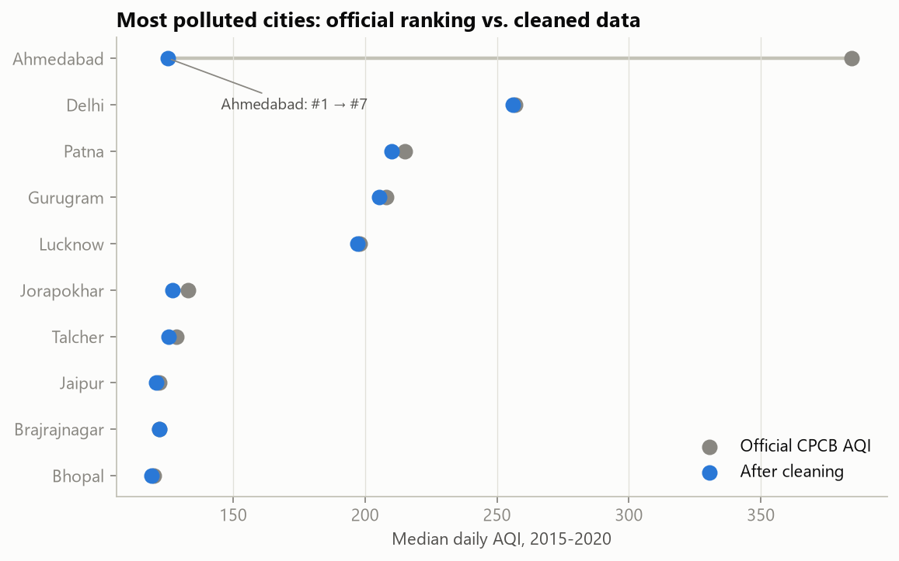
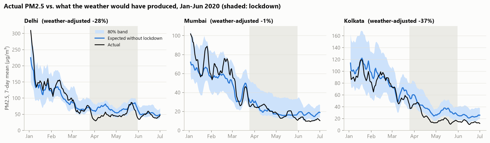
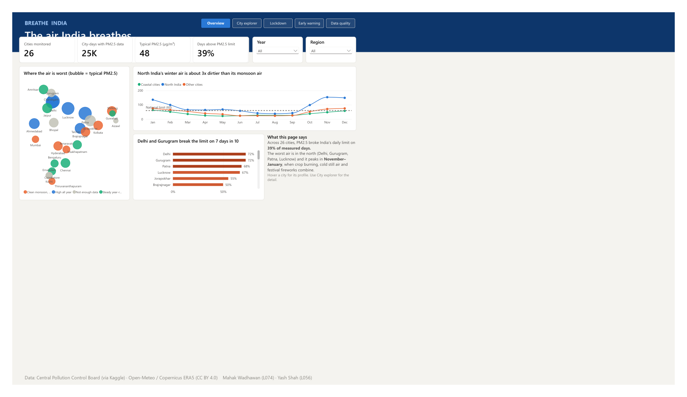

# Breathe India: what really drives air pollution in Indian cities?

Data Wrangling group project · **Mahak Wadhawan (L074)** · **Yash Shah (L056)**

How much of a city's daily air quality is driven by **weather and season** rather than **human activity**, and can we
predict tomorrow's air-quality category? We combine 5 years of government air-quality data for 26 Indian cities with
daily weather from a public API. The 2020 COVID-19 lockdown serves as a natural experiment.



## Key findings

1. **Wrangling changed the answer.** On the official numbers, Ahmedabad is India's most polluted city (median AQI 384).
   Its carbon-monoxide column turned out to be a copy of its nitric-oxide column (identical on 94% of days, r = 0.999).
   Once that is fixed, Ahmedabad drops to **#7** (median AQI 125).
2. **Season sets the baseline.** North India's winter air carries **3.3×** the PM2.5 of its monsoon air. On a typical
   November–January day it is about 2.5× the national 24-hour limit.
3. **Rain cleans the air, but less than it seems.** Heavy-rain days look 65% cleaner than dry days. Compared with the same
   city in the same month, the real washout effect is **23%**.
4. **About a third of the lockdown "drop" was weather.** PM2.5 fell 41% against spring 2019, but only **28%** once a
   weather-normalised model removes the weather. NO₂, mostly from traffic, really did fall about **46%**.
5. **Tomorrow is predictable, until the world changes.** A gradient-boosting model gets **75%** of next-day AQI categories
   exactly right (baseline 72%) and catches **92%** of Poor-or-worse days (baseline 80%). During the lockdown it did worse
   than the simple baseline.



## Pipeline

| Stage | What happens | Where |
|---|---|---|
| Extraction | Kaggle download (CPCB data), Open-Meteo Geocoding API, Open-Meteo Historical Weather API (rate-limited, cached), hand-built event calendar | `src/extract_aqi.py`, `src/extract_weather.py`, notebook §1 |
| Profiling | Missingness by city and pollutant, coverage timeline, impossible values | notebook §2 |
| Cleaning | 23 logged decisions: corrupted CO column, stuck sensors, impossible PM2.5 > PM10, sensor spikes vs real Diwali / crop-burning episodes, short-gap interpolation, AQI rebuilt with CPCB breakpoints | notebook §3, [`docs/cleaning_log.md`](docs/cleaning_log.md) |
| Transformation | Star schema, validated joins across 4 sources, lags via date-safe joins, rolling windows, melt and pivot reshapes, station-level aggregation | notebook §4 |
| Loading | SQLite with primary keys and validation queries; Parquet partitioned by year, validated per partition | notebook §5, `data/processed/` |
| Insights | 5 findings, each with a chart and a statistic | notebook §6, `figures/` |
| Machine learning | **A** next-day AQI category (classification, 3 models vs persistence baseline, time-series CV); **B** weather-normalised lockdown counterfactual (regression, placebo test, quantile bands); **C** k-means city clusters | notebook §7 |
| Dashboard | Power BI: 5 pages + hover tooltip page, generated from code and validated | `powerbi/Breathe_India.pbix`, `src/build_powerbi_project.py` |

## Power BI dashboard



| File | What it is |
|---|---|
| [`powerbi/Breathe_India.pbix`](powerbi/Breathe_India.pbix) | The dashboard: open in Power BI Desktop (free, Windows) |
| [`powerbi/Breathe_India_dashboard.pdf`](powerbi/Breathe_India_dashboard.pdf) | PDF export of all 5 pages (the fallback the guidelines ask for) |
| `powerbi/BreatheIndia/` | The same report as a Power BI project (PBIP: TMSL model + PBIR report JSON), generated by `src/build_powerbi_project.py` |

Pages: **Overview** (KPIs, city map, seasonal curve, worst cities) · **City explorer** (city × month heatmap, AQI bands,
stations) · **Lockdown** (actual vs weather-expected PM2.5/NO₂ with 80% band, naive vs adjusted by city) · **Early
warning** (model vs baseline, confusion matrix, top inputs, predicted vs actual) · **Data quality** (Ahmedabad
correction, missingness before/after, the full cleaning log). Hovering a city shows a custom tooltip page.

The `.pbix` contains its data, so it opens on any PC. To **refresh** from the CSVs on a different PC, open
Transform data → Edit parameters and point `DataFolder` at your copy of `powerbi/data/`. To rebuild the report from code:
`python src/build_powerbi_project.py`, then open `powerbi/BreatheIndia/BreatheIndia.pbip` and click Refresh.

## Data sources

| Source | Licence / terms |
|---|---|
| [Air Quality Data in India 2015–2020](https://www.kaggle.com/datasets/rohanrao/air-quality-data-in-india) (Kaggle; originally Central Pollution Control Board) | See the Kaggle page; underlying data is published by CPCB, Government of India |
| [Open-Meteo Historical Weather API](https://open-meteo.com/en/docs/historical-weather-api) (Copernicus ERA5 reanalysis) | CC BY 4.0. Free for non-commercial use, < 600 calls/min, < 10,000/day |
| [Open-Meteo Geocoding API](https://open-meteo.com/en/docs/geocoding-api) (GeoNames) | CC BY 4.0 |
| Lockdown phases and Diwali dates | Public government notifications and calendars |

## Run it

```bash
python -m venv .venv
.venv\Scripts\activate          # Windows; use source .venv/bin/activate on Mac/Linux
pip install -r requirements.txt
jupyter nbconvert --to notebook --execute --inplace notebooks/breathe_india_pipeline.ipynb
```

The notebook runs end to end in about 8 minutes. Raw files are already in `data/raw/`. If they are deleted, the
extraction scripts download them again (no API keys needed).

## Repository layout

```
data/raw/              CPCB daily files, weather API output (+ raw JSON per city), city coordinates
data/processed/        breathe_india.db (SQLite), parquet/fact_city_day/Year=YYYY/
notebooks/             breathe_india_pipeline.ipynb (the whole pipeline, with outputs)
src/                   extraction scripts, Power BI report generator, page-background generator
figures/               every chart in the notebook as PNG (for the report and slides)
docs/                  cleaning_log.md, key_results.json
powerbi/               Breathe_India.pbix + PDF, PBIP project, data CSVs/workbook, theme, backgrounds, DAX, BUILD_GUIDE.md
```

## Submission checklist

- [x] Jupyter notebook: wrangling + ML, runs end to end
- [x] Cleaning and transformation log (`docs/cleaning_log.md`, also in the notebook and database)
- [x] Raw and cleaned datasets + regeneration scripts
- [x] Power BI `.pbix` + PDF export (`powerbi/`)
- [x] Written report, 6 pages (`docs/report/Breathe_India_report.docx` + `.pdf`)
- [x] Presentation deck, 10 slides with speaker notes (`docs/presentation/Breathe_India_viva.pptx` + `.pdf`)
- [x] Individual contribution statement (report §8 and `docs/contribution_statement.txt`)
