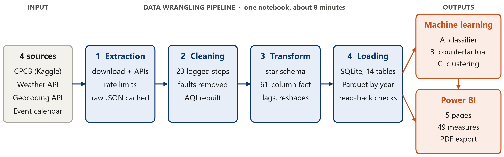
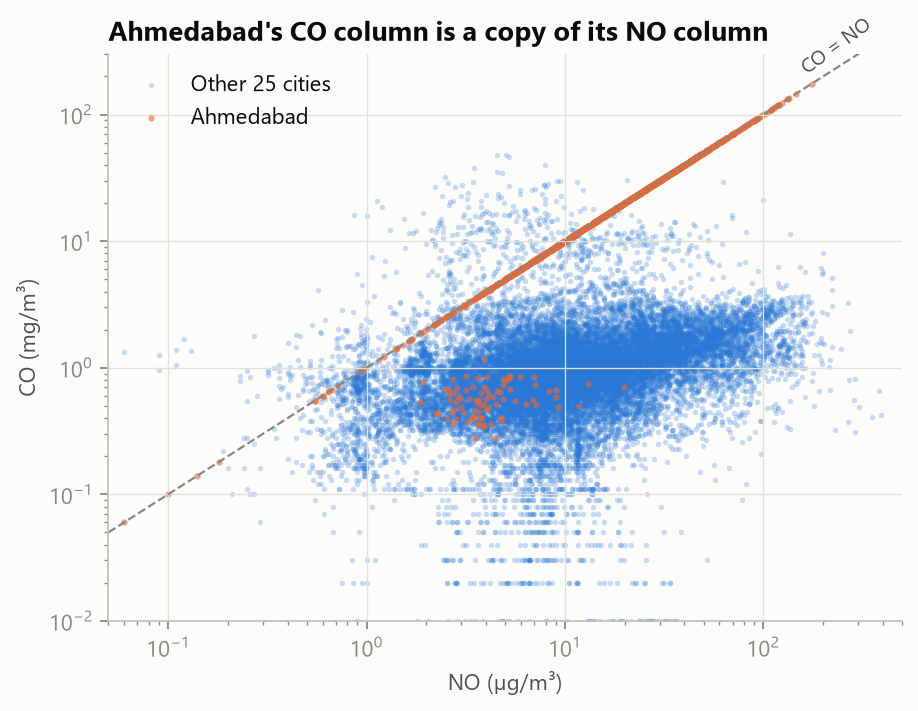
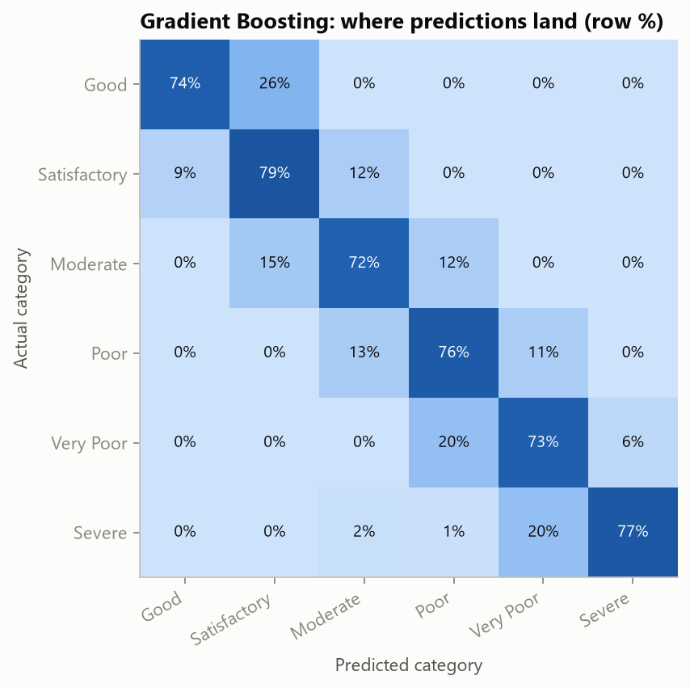
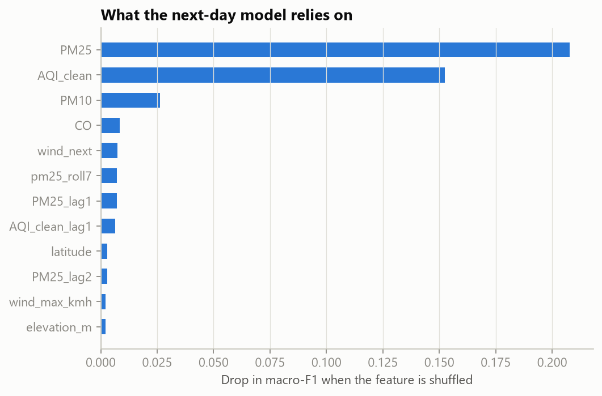
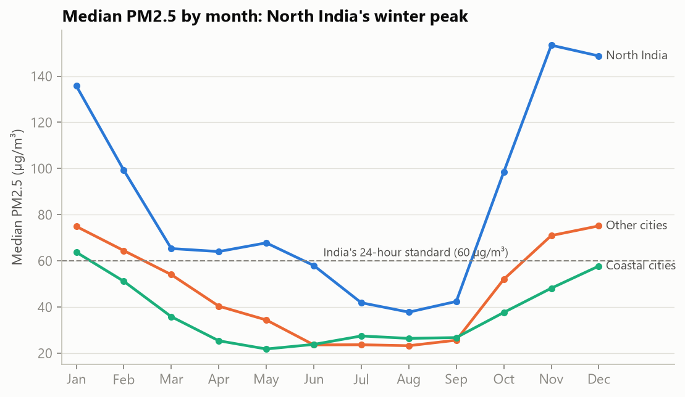
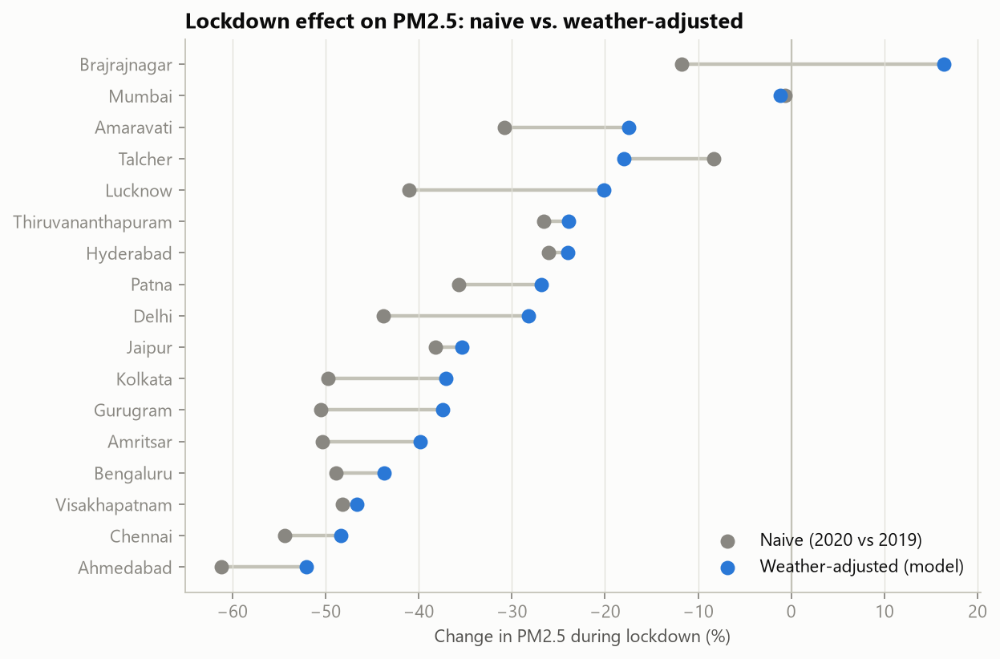
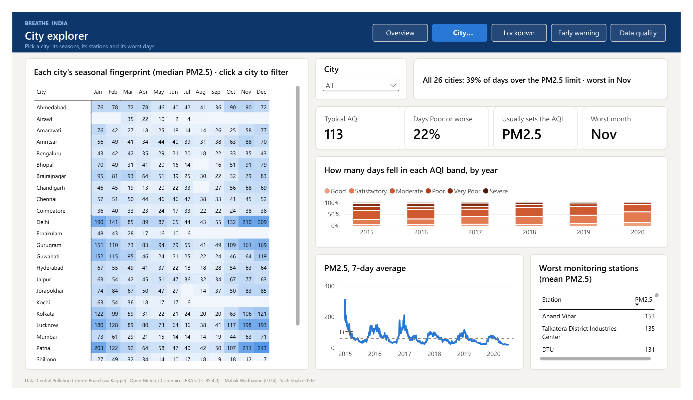
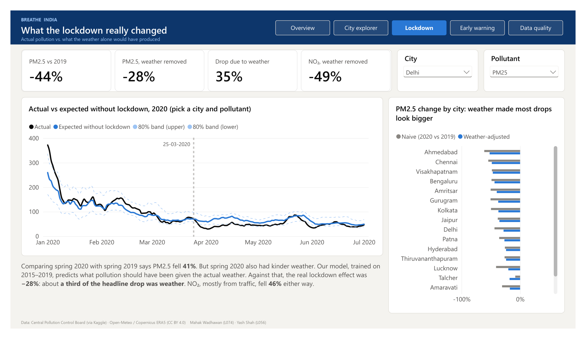
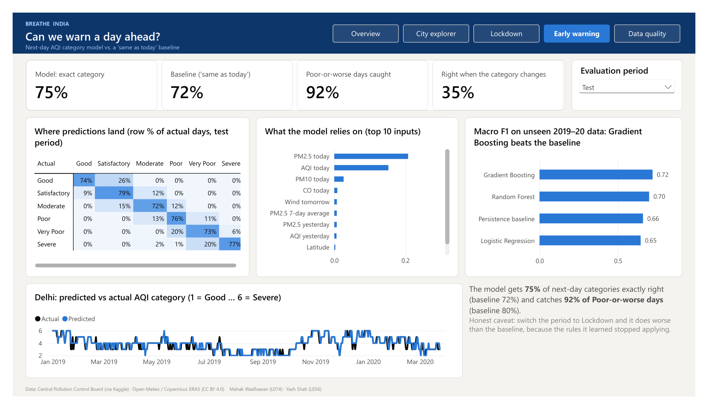
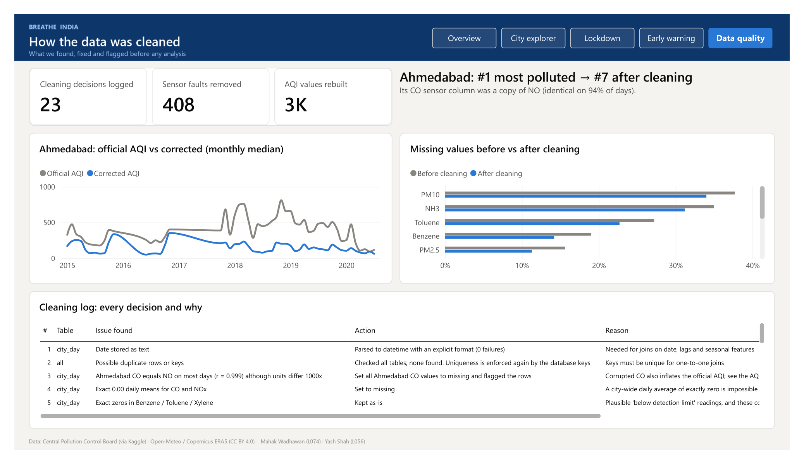

# Breathe India: What Really Drives Air Pollution in Indian Cities?

Data Wrangling Group Project · Mahak Wadhawan (L074) · Yash Shah (L056)

<!--
Source text of the written report. docs/report/build_report.py lays it out in Word with the cover page,
declaration, contribution table, contents and lists of figures and tables. Extra markup it understands:
  Table: caption {#label widths=cm,cm,... align=lccr}   caption and column widths for the next table
  {#label w=cm}                          a figure; two on one line sit side by side
  {Table:label} {Fig:label}                              numbered cross-references
  "include: path" in a comment                           the table from another markdown file
  "pagebreak" in a comment                               a page break
-->

## 1. Abstract

India's official air-quality data is too messy to answer even simple questions reliably. This project takes five and a half years (January 2015 to July 2020) of daily Central Pollution Control Board (CPCB) data for 26 cities through the full data-wrangling pipeline: extraction from Kaggle and two public weather APIs, cleaning with 23 logged and justified decisions, transformation into a star schema with engineered weather, calendar and lag features, and loading into SQLite and year-partitioned Parquet. The cleaned data then feeds three machine-learning tasks and a five-page Power BI dashboard. Wrangling changed the answers. Ahmedabad, the most polluted city on official numbers, turns out to be a sensor error: once its corrupted carbon-monoxide column is removed it ranks seventh. A weather-normalised model shows that about a third of the PM2.5 fall credited to the 2020 lockdown came from favourable weather (−41% naive, −28% adjusted), while the NO₂ fall of about 46% was real. A Gradient Boosting classifier predicts tomorrow's AQI category correctly 75% of the time and catches 92% of Poor-or-worse days, against 72% and 80% for a "same as today" baseline.

**Keywords:** data wrangling, air quality, CPCB, data cleaning, star schema, SQLite, weather normalisation, gradient boosting, Power BI.

## 2. Introduction

### 2.1 Background and motivation

Air pollution is one of India's largest public-health risks, and the CPCB reports a daily Air Quality Index (AQI) for every monitored city on a six-step scale from Good to Severe [1]. These numbers drive headlines, rankings and policy, yet they are published as raw sensor averages: stations start and stop, instruments freeze or saturate, and one city's numbers can be wrong for years without anyone noticing. Any answer drawn from this data depends first on how it is wrangled.

The 2020 COVID-19 lockdown makes the question sharper. On 25 March 2020 traffic and most industry stopped almost overnight [5], a change no policy could make on purpose. Pollution fell, and the headline "pollution fell by 40%" was widely repeated. But spring weather also differs from year to year, so a simple before-and-after comparison mixes two effects. Separating them needs pollution and weather data that are clean, aligned by city and day and joined without error, which is exactly what a data-wrangling pipeline provides.

### 2.2 Objectives

The project asks one question: how much of a city's daily air quality comes from weather and season, and how much from people? It breaks into four objectives:

1. **O1 – A reproducible pipeline.** Extract, clean, transform and load the pollution, weather and location data, logging and justifying every cleaning decision.
2. **O2 – Separate weather from people.** Use the 2020 lockdown as a natural experiment and estimate its effect with the weather removed.
3. **O3 – Warn a day ahead.** Test whether tomorrow's AQI category can be predicted better than a simple "same as today" baseline.
4. **O4 – Communicate.** Present the findings in a Power BI dashboard that a non-technical reader can explore.

## 3. Dataset Description

### 3.1 Data sources

Four sources were joined into one star schema of 28,260 city-days for 26 cities, from 1 January 2015 to 1 July 2020 ({Table:sources}). The CPCB data is the core: each city-day row holds 12 pollutant concentrations (PM2.5, PM10, NO, NO₂, NOx, NH₃, CO, SO₂, O₃, benzene, toluene and xylene), the official AQI and its category. The weather API adds eight daily variables: mean, maximum and minimum temperature, rainfall, humidity, maximum wind speed, wind direction and solar radiation. The dataset comfortably meets the project requirements: it is real public data, far larger than 1,000 rows and 8 columns, and it needs joins across several sources.

Table: Data sources used in the project {#sources widths=4.6,3.8,2.7,1.9,3.4}

| Source | How obtained | Rows × columns | Grain | Licence / terms |
| --- | --- | --- | --- | --- |
| [CPCB air quality, city level](https://www.kaggle.com/datasets/rohanrao/air-quality-data-in-india) (Central Pollution Control Board, via Kaggle) [2] | HTTP download of a 76 MB zip | 29,531 × 16 | city × day | Published by CPCB; Kaggle page licence |
| CPCB air quality, station level, and the station register | Same download | 108,035 × 16 and 230 × 5 | station × day | As above |
| [Open-Meteo Historical Weather API](https://open-meteo.com/en/docs/historical-weather-api) (Copernicus ERA5) [3], [4] | REST API, one call per city, 8 daily variables | 52,234 × 10 | city × day | CC BY 4.0, free for non-commercial use |
| [Open-Meteo Geocoding API](https://open-meteo.com/en/docs/geocoding-api) | REST API, one call per city | 26 × 8 | city | CC BY 4.0 |
| Event calendar | Typed in from government lockdown orders [5] and the festival calendar | 6 phases, 5 Diwali dates | date | Public record |

### 3.2 Problems in the raw data

The raw data needed real wrangling, not a tidy-up:

- **Heavy, uneven gaps.** Xylene is 61% empty, PM10 38% and the AQI 16%. Mumbai has no PM or AQI data before 2018.
- **An unbalanced panel.** Only 7 cities report AQI from 2015; others start as late as 2020.
- **Impossible values.** The AQI reaches 2,049 on a scale that ends at 500, CO and NOx have exact zeros, and PM2.5 exceeds PM10 on 256 days although PM2.5 is a subset of PM10.
- **Frozen and faulty sensors.** Jorapokhar reported exactly 11.00 µg/m³ of PM2.5 for 16 days (24 August to 8 September 2019), and Shillong, the cleanest city, "reads" 918 µg/m³ on a September day.
- **A corrupted column.** Ahmedabad's carbon monoxide equals its nitric oxide on 94% of days, although the two are reported in units a thousand times apart.
- **Names that disagree.** "Amaravati" matches three places in India, and "Brajrajnagar" is spelled differently across sources.

## 4. Methodology

The whole pipeline runs end to end in one Jupyter notebook in about 8 minutes, from the raw downloads to the database, the model outputs and the dashboard tables ({Fig:pipeline}). Every cleaning and transformation decision is logged with what was found, what was done and why: 23 entries, kept in the notebook, in `docs/cleaning_log.md`, in the database and in Appendix A. All code, data and outputs are in the GitHub repository [mahak2604/breathe-india](https://github.com/mahak2604/breathe-india).

{#pipeline w=16}

### 4.1 Data extraction

- **CPCB data** [2] is downloaded by `extract_aqi.py` from Kaggle's public dataset endpoint as a 76 MB zip. The browser download needs a Kaggle login; the public endpoint does not. Only the three daily files are kept; the 285 MB of hourly files are not needed.
- **Weather** [3], [4] comes from `extract_weather.py`, which calls the Open-Meteo historical API once per city for five and a half years of 8 daily variables. Such a request counts as many API calls, and after 7 cities the API answered HTTP 429 (rate limited). The extractor now pauses 15 s between cities, waits 65 s after a 429 and caches each city's raw JSON, so a rerun fetches only what is missing.
- **Locations** come from the Open-Meteo geocoding API, one call per city, and every match is checked against the city's state. The geocoder's "Jorapokhar" was a village about 160 km from the monitoring station, so Jharia (Dhanbad), where the station stands, is used instead.
- **Events:** the six lockdown phases from government orders [5] and five Diwali dates were typed in from public records.
- **Access and licensing:** no source needs authentication. The CPCB data is published by the Government of India; Open-Meteo data is licensed CC BY 4.0 and is credited on every dashboard page.

### 4.2 Data cleaning

Each problem got the treatment its cause called for, rather than one rule for everything: physically impossible values were removed, values that are unusual but real were kept and flagged, and short gaps were filled only where pollution is known to change smoothly. {Table:cleaning} lists the decisions that mattered most; Appendix A has all 23.

Table: The cleaning decisions that mattered most {#cleaning widths=3.8,4.0,6.4,2.2}

| Issue found | Action | Why | Values |
| --- | --- | --- | --- |
| Ahmedabad CO equals NO (r = 0.999) | CO set to missing; AQI recalculated without it | CO drove 95% of its official "Severe" days | 1,400 CO; 1,576 AQI |
| PM2.5 above PM10, which is physically impossible | Removed whichever reading was further from the city-month norm | The data showed PM2.5 was the faulty one in 94% of cases, overturning our first assumption | 256 |
| Sensor stuck on one value for 4+ days | Set to missing | Real daily averages never repeat to two decimals for days | 30 |
| Spikes more than 3.5 robust SD above the city-month norm | Set to missing, except during Diwali and the crop-burning season | 55% fell in the monsoon, including 918 µg/m³ in Shillong, the cleanest city | 167 removed, 5 kept |
| Exact 0.00 for CO and NOx | Set to missing | A city-wide daily mean of zero is impossible | 3,068 |
| Gaps of 1–3 days | Linear interpolation within the city | Pollution changes smoothly over a few days; longer gaps stay missing | 3,700 |
| Official AQI above 500 | Capped at 500 | 500 is the top of the CPCB scale | 543 |
| AQI missing although pollutants were measured | Filled with our CPCB-breakpoint recalculation, flagged by source | The recalculation matches the official AQI with r = 0.94, within one category 99% of the time | 1,044 |

Two decisions changed the project's conclusions. First, PM2.5 above PM10 is impossible, and we first assumed PM10 was the faulty reading. Comparing each value with the city's normal level for that month showed the opposite: PM2.5 was the abnormal one in 94% of the 256 cases. Second, Ahmedabad's carbon-monoxide readings sit exactly on the line CO = NO ({Fig:co}), which is impossible because CO is reported in mg/m³ and NO in µg/m³. CO drove 95% of the city's official "Severe" days, so the official numbers rank Ahmedabad as the most polluted city in the data. Recalculated from the CPCB breakpoints [1] without CO, it ranks seventh ({Fig:ranking}).

{#co w=6.0} {#ranking w=7.2}

### 4.3 Data transformation

- **Joins into a star schema.** Pollution, weather, coordinates and the event calendar are joined on city and date into a city-day fact table of 28,260 rows × 61 columns, with city, date, station and AQI-category dimensions. Every pandas join [8] declares its expected cardinality with the `validate` option, so a duplicated key stops the notebook instead of silently multiplying rows.
- **Engineered features.** Day-night temperature range; wind as a vector (u, v), so that 359° sits next to 1°; the sine and cosine of the day of year; Diwali-window and crop-burning-season flags; the lockdown phase; and each day's PM2.5 relative to the same city's median for that month.
- **Time features.** Yesterday's and the day before's values are joined by calendar date rather than shifted by row, so a gap in the data never pairs a day with the wrong "yesterday"; a 7-day rolling mean of PM2.5 is added too.
- **Reshapes and aggregations.** A melt to 165,506 city-day-pollutant rows for the dashboard, a city × month pivot for the seasonal heatmap, and region × season and station-level group-by aggregations.

### 4.4 Data loading and storage

- **SQLite** (`breathe_india.db`, 14 tables, 26 MB): one table per entity with unique indexes as primary keys, plus the model outputs, the cleaning log and a data-quality table. After loading, read-back checks confirm that row counts match, no key is orphaned and the PM2.5 total agrees to the decimal. An analytical SQL query then ranks cities by days over the PM2.5 limit: Delhi exceeds it on 72.4% of days.
- **Parquet**, partitioned by year (`fact_city_day/Year=2015` to `Year=2020`) and validated by comparing row counts per partition with the source table.
- **Power BI feed:** the same tables as CSV files and a one-file Excel workbook.

## 5. Machine Learning

Three tasks, one per question, each judged against a simple baseline on data the model never saw. All splits are in time order: a random split would leak the future, because tomorrow's pollution closely follows today's. All preprocessing (imputation, scaling and one-hot encoding) sits inside scikit-learn pipelines [7], so it is fitted on the training folds only.

### 5.1 Model A: tomorrow's AQI category (classification)

- **Target:** the next day's official CPCB category, six classes from Good to Severe. Ahmedabad and every recalculated day are excluded, so the model never learns from our own corrections.
- **Inputs:** today's pollutants, AQI and recent history; today's and tomorrow's weather (a stand-in for a forecast); the calendar; and city geography.
- **Split:** train on target days up to the end of 2018 (12,315 rows, 17 cities); test on January 2019 to 24 March 2020 (8,554 rows); and a separate stress test on the lockdown.
- **Model choice:** Logistic Regression as a simple linear model, and Random Forest and Gradient Boosting because tree ensembles capture non-linear weather effects and interactions without hand-made feature crosses. Five-fold time-series cross-validation picked Gradient Boosting, and a small grid tuned it (learning rate 0.03, 31 leaves).

Table: Model A on the test period, January 2019 to March 2020 {#modela widths=5.0,2.0,2.0,3.4,4.0 align=lcccc}

| Model | Accuracy | Macro F1 | Poor-or-worse days caught | Right when the category changed |
| --- | --- | --- | --- | --- |
| Persistence baseline ("same as today") | 0.72 | 0.66 | 80% | 0% |
| Logistic Regression | 0.69 | 0.65 | 93% | 41% |
| Random Forest | 0.76 | 0.70 | 90% | 33% |
| **Gradient Boosting (chosen)** | **0.75** | **0.72** | **92%** | **35%** |

Gradient Boosting has the best macro F1, which weights all six categories equally, and 99.7% of its predictions are right or one category off ({Fig:confusion}). Its value lies on the days the air changes category, which the baseline gets wrong by definition; today's PM2.5 and AQI are its most important inputs ({Fig:importance}). It also fails honestly: in cross-validation on 2015–18 it only matched the baseline (macro F1 0.62 each), and during the lockdown its macro F1 fell to 0.59, below the baseline's 0.65, because the patterns it had learned stopped applying.

{#confusion w=5.0} {#importance w=7.6}

### 5.2 Model B: what the lockdown really changed (counterfactual regression)

Model B predicts daily PM2.5 and NO₂ from weather, season, day of week, long-term trend and city only, never from pollution itself. Trained on the years before 2020 and fed the real spring-2020 weather, it estimates what pollution would have been without a lockdown; the gap between that expectation and reality is the lockdown effect with the weather removed ({Fig:counterfactual}). A counterfactual cannot be checked directly, so the model was first tested where the answer is known ({Table:modelb}).

Table: Checks and results for Model B {#modelb widths=6.6,9.8}

| Check | Result |
| --- | --- |
| Placebo: predict spring 2019, when nothing happened | Random Forest R² 0.55, bias −2%; city-month average R² 0.44; Ridge 0.38 |
| Out-of-sample, 1 January to 24 March 2020 | R² 0.67, bias +4%: it tracked reality right up to the lockdown |
| 80% prediction band (quantile Gradient Boosting) | Covered 73% of days: slightly too narrow, so read it as indicative |
| Lockdown effect on PM2.5, median of 17 cities | −41% naive against **−28% weather-adjusted** |
| Lockdown effect on NO₂, median of 17 cities | −47% naive against **−46% weather-adjusted** |

{#counterfactual w=14.5}

The naive comparison credits the lockdown with a 41% fall in PM2.5; with the weather removed the fall is 28%, so about a third of the headline drop was favourable weather. For NO₂, which comes mainly from traffic, the two estimates agree (−47% and −46%): that fall was real.

### 5.3 Model C: three kinds of city air (clustering)

K-means on two standardised features per city, typical PM2.5 level and the winter-to-monsoon ratio, gives three groups; k = 3 was chosen by silhouette score (0.41). **High all year:** Delhi, Gurugram, Lucknow, Patna, Brajrajnagar and, after cleaning, Ahmedabad. **Clean monsoon, smoggy winter:** Mumbai, Kolkata, Guwahati, Hyderabad, Talcher, Amaravati and Thiruvananthapuram. **Steady year-round:** Bengaluru, Chennai, Coimbatore, Shillong, Visakhapatnam, Amritsar and Jaipur. Six cities with under a year of data are left unclustered rather than forced into a group. The clusters colour the city map on the dashboard.

## 6. Power BI Dashboard

The dashboard (`Breathe_India.pbix`, with a PDF export) answers one question per page for a non-technical reader ({Table:pages}). It reads the cleaned tables and the model outputs through 13 related tables and 49 DAX measures. Every visual title states its finding rather than its field names, and each page ends with a short plain-language note.

Table: The five dashboard pages {#pages widths=2.3,3.4,6.5,4.2}

| Page | The question it answers | What is on it | What the reader can do |
| --- | --- | --- | --- |
| Overview | Where and when is the air worst? | Four headline numbers, a map of the cities sized by typical PM2.5 and coloured by cluster, the monthly curve for North, coastal and other cities against the 60 µg/m³ limit [6], cities ranked by days over the limit | Filter by year and region; hover a city for a custom tooltip page with its own profile |
| City explorer | What is one city's year like? | City × month heatmap, a one-line summary sentence, AQI bands by year in the CPCB colour order, a 7-day PM2.5 line, the worst monitoring stations | Click a city in the heatmap or pick it from a dropdown to filter the page |
| Lockdown | What did the lockdown really change? | Naive and weather-adjusted change, the share due to weather, actual against expected PM2.5 or NO₂ with an 80% band and a marker on 25 March, naive and adjusted change by city | Choose the city and the pollutant (opens on Delhi, PM2.5) |
| Early warning | Can we warn a day ahead? | Model and baseline accuracy, Poor-or-worse days caught, the confusion matrix, the top 10 inputs, models compared on macro F1, Delhi predicted against actual | Switch the period from Test to Lockdown to watch the model fall below the baseline |
| Data quality | Can these numbers be trusted? | Cleaning decisions and sensor faults counted, Ahmedabad's official and corrected AQI, missing values before and after cleaning, the full cleaning log | Read every decision and its reason |

**Interactivity:** year, region, city, pollutant and evaluation-period slicers; a heatmap that filters its page when a city is clicked; a custom tooltip page that shows a city's own profile on hover; and page-navigation buttons. **Build:** the report is generated from code (`src/build_powerbi_project.py`) as a Power BI project, checked with Microsoft's report validator, refreshed in Power BI Desktop and saved as the `.pbix` [9]. A custom theme, page backgrounds and a colour-blind-checked palette keep the five pages consistent. Appendix B shows all five pages as exported.

## 7. Insights

Five findings, each tested against the cleaned data rather than assumed. The first would have been wrong without the cleaning, and the third and fourth could not be measured without the weather join.

1. **India's "most polluted city" in this data is a data error.** On official numbers Ahmedabad ranks first, with a median AQI of 384. Its CO column copies its NO column, and CO drove 95% of its AQI-above-400 days. Corrected, its median AQI is 125 and it ranks seventh ({Fig:ranking}).
2. **North India's winter air carries 3.3 times the PM2.5 of its monsoon air.** The median November–January day reaches 148 µg/m³, about 2.5 times the national 24-hour limit of 60 [6], against 44 in June–September. Coastal cities swing only 2.2 times. Delhi and Gurugram break the limit on 72% of days ({Fig:season}).
3. **Rain cleans the air, but a third as much as it seems.** A raw comparison says heavy-rain days have 65% less PM2.5 than dry days. Against the same city in the same month the washout effect is 23%, because heavy rain mostly falls in the already-clean monsoon. Wind matters less: the windiest quarter of days is 10% cleaner than the calmest.
4. **The lockdown cut particles and NO₂, but not ozone, and the weather flattered the particles.** Against spring 2019, PM2.5 fell about 40% and NO₂ about 45% (median city), while ozone barely moved (−2%) and rose in 8 of 18 cities: less traffic NO left more ozone intact. With the weather removed (Model B), the real PM2.5 effect is −28%, and it differs widely between cities ({Fig:naive}).
5. **Diwali leaves a mark every year.** In North India, PM2.5 on the day after Diwali is about 2.5 times its level in the week before (other cities: 1.9 times). It peaks the day after because daily averages run midnight to midnight and fireworks run late.

{#season w=6.6} {#naive w=6.2}

## 8. Limitations

The conclusions hold for the monitored parts of 26 cities from 2015 to mid-2020. These are the places where they could be biased:

- **Measurement, not exposure.** A city's value averages a handful of stations (it matches the station average with r = 0.997), so it describes the monitored areas, not every neighbourhood.
- **Uneven coverage.** Only 7 cities report AQI from 2015 and Mumbai has nothing before 2018. Rankings use each city's own period, and late-starting cities are missing from Model A's training years.
- **Our corrections are assumptions.** Ahmedabad's AQI is our recalculation from daily averages; CPCB uses hourly data with 8-hour maxima for CO and ozone. It agrees with the official AQI within one category 99% of the time, not exactly.
- **Removing sensor faults is a judgement.** A 3.5-SD rule with Diwali and crop-burning exceptions could drop a rare real spike outside those windows, and interpolating 1–3 day gaps smooths some real day-to-day variation.
- **Model A uses tomorrow's actual weather** as a stand-in for a forecast, so a deployed system would be somewhat less accurate.
- **Model B assumes the 2015–19 "normal" would have continued in 2020.** Anything else that changed that spring, such as fireworks rules or crop burning, lands in the "lockdown effect", and its 80% band covered only 73% of days.
- **Weather is reanalysis.** ERA5 is a roughly 25 km grid and smooths local extremes.
- **The data ends on 1 July 2020,** so how fast pollution returned after unlocking is not covered.

## 9. Conclusion and Future Work

Wrangling was not a preliminary chore in this project; it changed the answers. Without cleaning, Ahmedabad would be India's most polluted city, and without the weather join the lockdown would appear to have cut particle pollution by 41% rather than 28%. All four objectives were met: a reproducible pipeline with every decision logged (O1); a lockdown effect estimated with the weather removed and checked with a placebo test (O2); a next-day classifier that beats the baseline on normal days and is honest about where it fails (O3); and a dashboard that lets a non-technical reader explore each result (O4).

Future work could extend this in four directions:

- Extend the data beyond July 2020 to measure how quickly pollution returned after the lockdown was lifted.
- Use hourly data to compute the AQI exactly as CPCB does, with 8-hour maxima for CO and ozone.
- Replace tomorrow's actual weather in Model A with archived forecasts, to measure the accuracy a real warning system would achieve.
- Add satellite measurements of NO₂ and aerosols to cover the areas between monitoring stations.

## References

1. Central Pollution Control Board (2014). *National Air Quality Index*. Ministry of Environment, Forest and Climate Change, Government of India.
2. Rao, V. (2020). [Air Quality Data in India (2015–2020)](https://www.kaggle.com/datasets/rohanrao/air-quality-data-in-india). Kaggle; data from the Central Pollution Control Board.
3. Zippenfenig, P. (2023). [Open-Meteo.com Weather API](https://open-meteo.com/en/docs/historical-weather-api). Zenodo, doi:10.5281/zenodo.7970649. Licensed CC BY 4.0.
4. Hersbach, H. et al. (2020). The ERA5 global reanalysis. *Quarterly Journal of the Royal Meteorological Society*, 146, 1999–2049.
5. Ministry of Home Affairs (2020). Order No. 40-3/2020-DM-I(A) of 24 March 2020 and subsequent lockdown extension orders.
6. Central Pollution Control Board (2009). *National Ambient Air Quality Standards* (PM2.5, 24-hour: 60 µg/m³).
7. Pedregosa, F. et al. (2011). Scikit-learn: Machine learning in Python. *Journal of Machine Learning Research*, 12, 2825–2830.
8. McKinney, W. (2010). Data structures for statistical computing in Python. *Proceedings of the 9th Python in Science Conference*, 56–61.
9. Microsoft (n.d.). [Power BI documentation](https://learn.microsoft.com/power-bi/). Microsoft Learn.

<!-- pagebreak -->

## Appendix A. Cleaning and Transformation Log

All 23 decisions in the order the notebook applies them. The same log is stored in the notebook, in `docs/cleaning_log.md` and as the `cleaning_log` table in the database.

Table: The complete cleaning and transformation log {#log widths=0.6,2.1,3.9,3.8,4.8,1.8 align=lllllr size=8.5}

<!-- include: ../cleaning_log.md -->

## Appendix B. Dashboard Pages

The five report pages as exported to PDF from Power BI Desktop. The interactive version is `Breathe_India.pbix`, and the City tooltip page appears when the reader hovers over a city.

{#app1 w=15.5}

{#app2 w=15.5}

{#app3 w=15.5}

{#app4 w=15.5}

{#app5 w=15.5}
